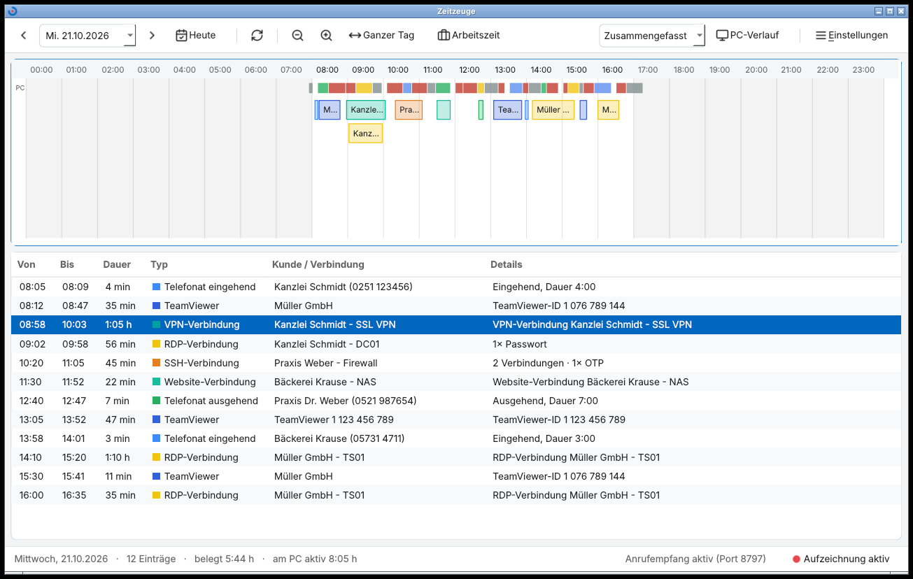
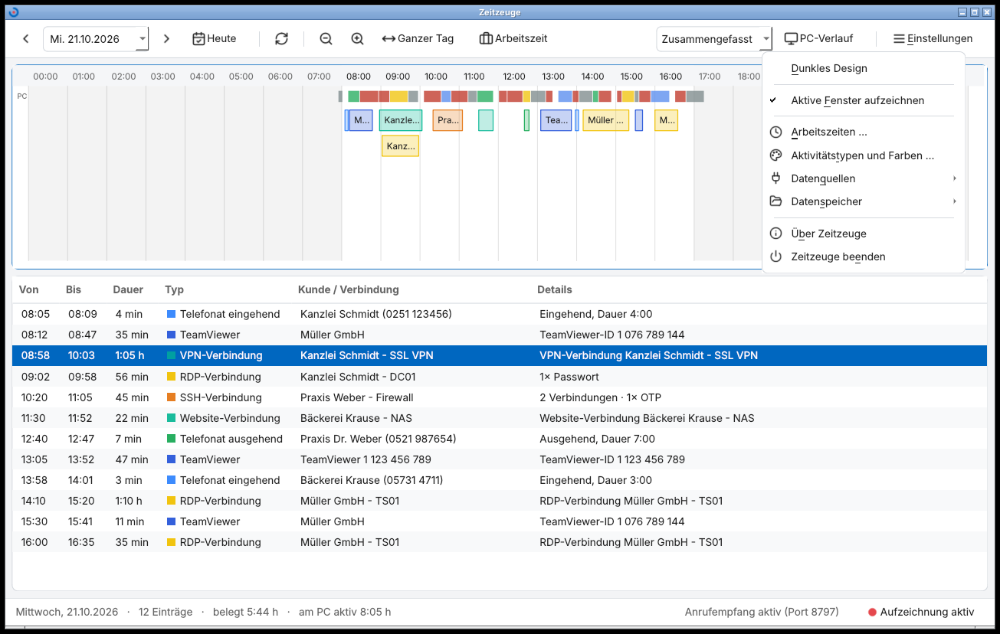
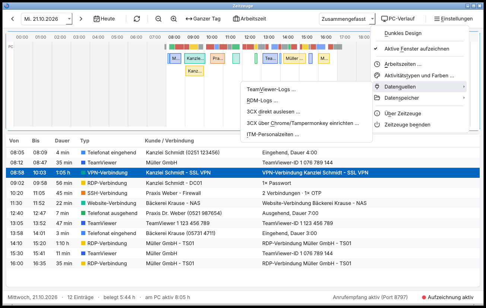
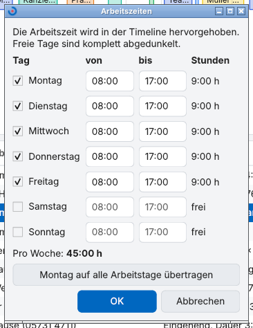
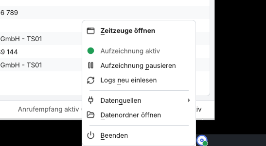
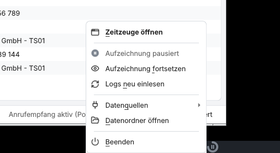
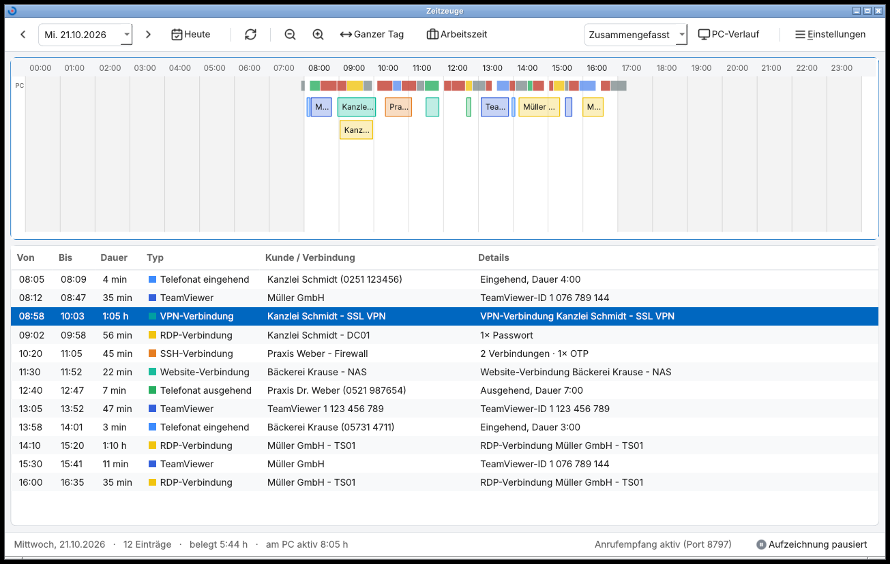
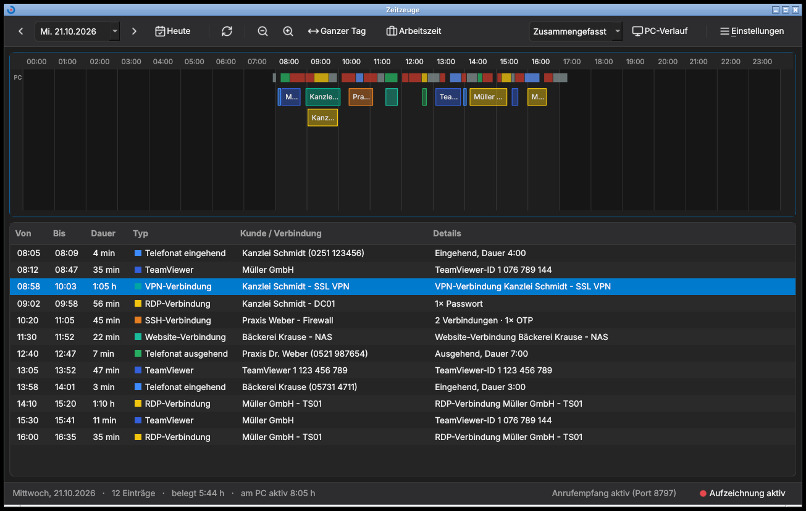

# Übergabe 22.10.2026: Startzeit, Oberfläche, Menüs, Infobereich

Branch: `claude/codebase-analysis-optimization-lnxdtt` (aus `main` @ `39abfb1`). Nichts ist nach
`main` gemerged, es gibt noch keinen Pull Request. Keine Daten gelöscht, keine Zugangsdaten,
externen Dienste oder Config-Formate angefasst.

## Kurzfassung

- **Start:** Das Fenster erscheint jetzt nach ~0,12 s, egal wie groß die Logs sind
  (vorher 2,6 s bei 3 Jahren Beispiel-Logs). Logs werden im Hintergrund gelesen.
- **Oberfläche:** einheitliche Linien-Icons, deutsche Standardknöpfe, klarere Abstände,
  Hell/Dunkel konsistent.
- **Menü:** nach Aufgaben gegliedert, Seltenes in Untermenüs „Datenquellen“ und „Datenspeicher“.
- **Infobereich:** Aufzeichnung direkt pausieren/fortsetzen, Zustand am Symbol (grün / grau mit
  Pause), im Menü und in der Statuszeile sichtbar.
- **Fehler behoben:** Bei ausgeschalteter Aufzeichnung verschwand das bereits Aufgezeichnete
  des Tages aus der Timeline.
- Alle Tests grün (lokal und Windows-CI), 2 neue Tests.

## Befunde und Entscheidungen

| Befund | Entscheidung |
|---|---|
| Beim Start wurden TeamViewer- und RDM-Logs **komplett und blockierend** gelesen, bevor das Fenster erschien. `strptime` kostete ~75 % davon. | Schnelles Datumslesen, Lesen im Hintergrund-Thread, erstes Zeichnen erst nach dem Anzeigen. |
| Die Aktualisierung alle 2 Minuten las geänderte Logs ebenfalls blockierend (bei RDM-Logs, die sich oft ändern, ruckelte die Oberfläche; bei Netzwerkpfaden länger). | Läuft jetzt ebenfalls im Hintergrund. |
| Parser holten ihre Config, indem sie alle offenen Fenster nach einem `config`-Attribut durchsuchten. Zwei fast gleiche Einlese-Schleifen. | Config wird direkt übergeben, eine gemeinsame Schleife (−200 Zeilen). Ergebnis auf 126.000 Logzeilen **identisch** zum alten Parser geprüft. |
| Edge-Steuerung (`websocket`, `psutil`, `urllib`) wurde immer geladen, obwohl 3CX/ITM standardmäßig aus sind. | Lädt erst bei Bedarf (−35 ms Import). |
| Dialogknöpfe englisch („Cancel“, „Close“), weil keine Qt-Übersetzung geladen war. | `qtbase_de` wird geladen; fehlt die Datei, bleibt es wie bisher (kein Fehler). |
| Pfeile in Zeit- und Zahlenfeldern wurden durch das Stylesheet kaputt gezeichnet. | Pfeile ausgeblendet; Eingabe per Tastatur, Pfeiltasten, Mausrad. |
| Menü „Einstellungen“: 12 Einträge flach. Werkzeugleiste mit Unicode-Zeichen, bei 1200 px rutschte „Einstellungen“ in den Überlauf. | Menü nach Aufgaben, Icons, „Dunkel“ ins Menü, „Aktualisieren“ nur als Icon (Tooltip + F5). |
| Infobereich nur „Öffnen“ und „Beenden“, Aufzeichnung nur tief im Menü schaltbar. | Siehe unten. Eine gemeinsame `QAction` für Menü, Infobereich und Statuszeile, damit der Zustand nie auseinanderläuft. |
| Architektur: flache Module nach Zuständigkeit (Parser, Tracker, Leser, Dialoge, Timeline, Hauptfenster). | **Kein Umbau.** Die Struktur passt zur Größe (~4.000 Zeilen). Nur die Kopplung Parser→Fenster gelöst. Weitere Aufteilung siehe offene Punkte. |

**Annahmen:** Die Pause der Aufzeichnung bleibt nach einem Neustart erhalten (wie der bisherige
Menüschalter, Config-Schlüssel `tracking_enabled`). Deutlich erkennbar über das graue Symbol.
Die Größe „3 Jahre Logs“ (8 MB RDM, 1,2 MB TeamViewer) ist geschätzt; echte Logs können kleiner
oder größer sein.

## Umgesetzte Änderungen

| Commit | Inhalt | Dateien |
|---|---|---|
| `01a2940` | Messwerkzeuge und Vorher-Bilder | `tests/start_bench.py`, `tests/screenshots.py`, `tests/screenshots.sh`, `docs/screenshots/2026-10-22/vorher/` |
| `dfee077` | Start: Fenster sofort, Logs im Hintergrund, schneller Parser | `log_parsers.py`, `timeline_only.py`, `main_timeline.py`, `grouping.py`, `settings_dialogs.py` (ungenutzten `TapiSettingsDialog` entfernt) |
| `b39f394` | Oberfläche, Menü, Infobereich, PC-Band bei Pause, neue Tests | `icons.py` (neu), `main_timeline.py`, `timeline_only.py`, `activity_tracker.py`, `tests/tray_test.py` (neu), `tests/parser_test.py` (neu), `tests/ui_audit_test.py`, `.github/workflows/build.yml` |
| `41b0103` | Doku, Screenshots, doppelter Aktivitätstyp, kaputte Umlaute in Kommentaren | `README.md`, `docs/…`, `main_timeline.py` |

### Neue Bedienung im Überblick

- **Werkzeugleiste:** ‹ Datum › Heute | ⟳ | Zoom − + Ganzer Tag Arbeitszeit · Ansicht der Liste,
  PC-Verlauf | ☰ Einstellungen
- **Einstellungen:** Dunkles Design · Aktive Fenster aufzeichnen · Arbeitszeiten …, Aktivitätstypen
  und Farben …, Datenquellen ▸, Datenspeicher ▸ · Über Zeitzeuge, Zeitzeuge beenden
- **Infobereich:** **Zeitzeuge öffnen** · ● Aufzeichnung aktiv / ‖ pausiert, Aufzeichnung
  pausieren / fortsetzen, Logs neu einlesen · Datenquellen ▸, Datenordner öffnen · Beenden
- **Statuszeile rechts:** Knopf „Aufzeichnung aktiv / pausiert“, ein Klick schaltet um.

## Startzeit: Messung

`python tests/start_bench.py 7 [Log-Ordner]`, je 7 frische Prozesse, Median, Linux ohne Bildschirm
(offscreen). Beispiel-Logs: 3 Jahre, 109.655 RDM- und 16.425 TeamViewer-Zeilen.

| Szenario | Messpunkt | vorher | nachher |
|---|---|---|---|
| ohne Logs | Fenster sichtbar und gezeichnet | 144 ms | 105 ms |
| ohne Logs | alle Daten gezeichnet | 152 ms | 114 ms |
| 3 Jahre Logs | Fenster sichtbar und gezeichnet | **2.621 ms** | **119 ms** |
| 3 Jahre Logs | alle Daten gezeichnet | 2.636 ms | 932 ms |
| — | Import der Module | 103 ms | 67 ms |

Einzeln gemessen: TeamViewer-Parser 0,37 s → 0,09 s, RDM-Parser 1,63 s → 0,61 s (gleiches Ergebnis).
Unter Windows ist alles langsamer (Virenscanner, EXE-Entpacken), das Verhältnis sollte gleich bleiben.

## Tests

| Test | Ergebnis |
|---|---|
| `tests/start_test.py`, `ui_audit_test.py` (0 Befunde), `grouping_test.py`, `smoke_test.py` | grün |
| neu: `tests/tray_test.py` (Menü, pausieren/fortsetzen über Infobereich und Statuszeile, Zustand gespeichert, PC-Daten bei Pause sichtbar) | grün |
| neu: `tests/parser_test.py` (Zeitzone, zu kurze/ungültige Zeilen, Cache, strenges Zeitformat) | grün |
| Alter vs. neuer Parser auf 126.000 Logzeilen | identisch |
| Windows-CI (GitHub Actions, windows-latest): alle 15 Schritte inkl. neuer Tests, 3CX/ITM mit echtem Edge und EXE-Bau | grün (Lauf 33 und 34) |
| Echtes Beenden (`Beenden` im Menü, 10× alt und 10× neu) | 0 Abstürze |
| Sichtprüfung hell und dunkel per Screenshots | ok |

## Screenshots

Ordner [`docs/screenshots/2026-10-22/`](screenshots/2026-10-22/) mit Bildübersicht
([README](screenshots/2026-10-22/README.md)). Die wichtigsten:

| | |
|---|---|
| Hauptfenster |  |
| Menü Einstellungen |  |
| Untermenü Datenquellen |  |
| Dialog Arbeitszeiten |  |
| Infobereich, Aufzeichnung aktiv |  |
| Infobereich, Aufzeichnung pausiert |  |
| Hauptfenster, pausiert |  |
| Dunkles Design |  |

## Bekannte Einschränkungen

- **Kein Windows-Rechner zur Hand.** Lokal unter Linux getestet; Windows nur über die CI
  (Tests + EXE-Bau). Nicht von Hand geprüft: echtes Aussehen mit Segoe UI, Infobereich von
  Windows 11, 150 %/200 % Anzeige, Sprachausgabe.
- Screenshots unter Linux: Fensterrahmen, Taskleiste und Schrift (Inter statt Segoe UI) weichen ab.
- Deutsche Qt-Übersetzung in der EXE: Laut PyInstaller-Hook (6.11.1) werden die
  `qtbase`-Übersetzungen mit QtCore eingepackt. In der fertigen EXE selbst nicht ausprobiert.
  Falls sie fehlt, bleiben die Knöpfe englisch wie bisher, ohne Fehler.
- QtSvg kommt neu in die EXE (unter 1 MB), wird über `import` in `icons.py` sicher erkannt.
- Zeit- und Zahlenfelder haben keine Pfeilknöpfe mehr (Tastatur/Mausrad gehen).
- Das Screenshot-Skript beendet sich hart (`os._exit`), weil PyQt dort ohne Event-Loop beim
  Aufräumen sporadisch abstürzt. Das passiert auch mit dem alten Code und **nicht** in der App.
- Beim allerersten Bild nach dem Start fehlen Logs für Bruchteile einer Sekunde
  (Statuszeile: „Logs werden gelesen …“), dann erscheinen sie.

## Rückbau

Alles liegt nur auf dem Branch. `main` ist unverändert.

- **Alles verwerfen:** Branch nicht mergen (oder löschen). Lokal: `git checkout main`.
- **Nach einem Merge alles zurück:** `git revert 41b0103 b39f394 dfee077 01a2940`
  (neueste zuerst), dann pushen.
- **Nur die Oberfläche zurück, Startzeit behalten:** `git revert 41b0103 b39f394`.
- **Nur die Startzeit zurück:** `git revert dfee077` (Konflikte in `main_timeline.py`
  möglich, dann zuerst die Oberflächen-Commits zurücknehmen).
- **Daten:** Es gibt keine Migration. Config, Anrufe und Aktivitätsprotokoll bleiben
  kompatibel. Einzige Änderung beim Start: doppelte Aktivitätstypen werden aus der Config entfernt.
  Ist die Aufzeichnung pausiert, wieder einschalten oder `"tracking_enabled": true` setzen.

## Offene Punkte und nächste Schritte

1. **EXE auf Windows ausprobieren** (Artefakt der CI): Start, Infobereich, Pause, Dialog
   auf Deutsch, 150 % Anzeige. Danach PR nach `main`.
2. **EXE-Startzeit messen und ggf. auf „onedir“ umstellen.** Die EXE ist eine Einzeldatei
   (`onefile`): Bei jedem Start entpackt sie alle Qt-Bibliotheken ins Temp-Verzeichnis, typisch 1–3 s und
   vom Virenscanner verlangsamt. Ein Ordner-Build startet meist deutlich schneller, ändert aber
   die Verteilung (Ordner statt einer Datei, Autostart-Verknüpfung anpassen). Deshalb nicht
   auf Verdacht umgestellt.
3. **Pause mit Zeitlimit** (z. B. „für 1 Stunde pausieren“), falls vergessenes Pausieren
   ein Problem wird.
4. `main_timeline.py` (≈1.260 Zeilen) bei Gelegenheit teilen: Config-Laden und Design
   (`THEMES`, Stylesheet) in eigene Module. Die Timeline-Farben stehen noch separat in
   `timeline_only.py` statt in `THEMES`.
5. Ungenutzte Config-Schlüssel `auto_start`, `suggestion_colors` entfernen (harmlos).
